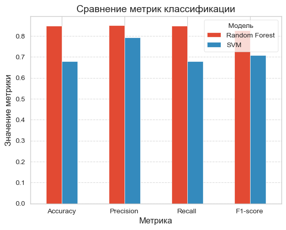
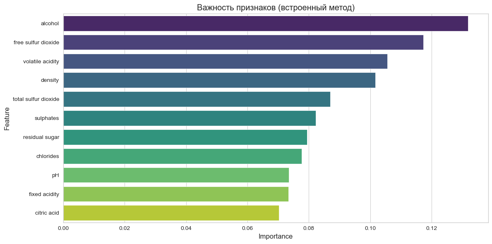
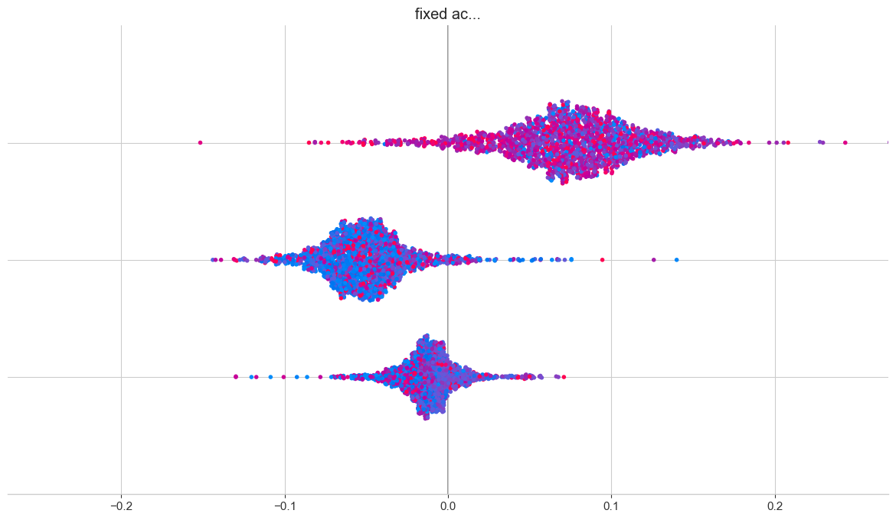
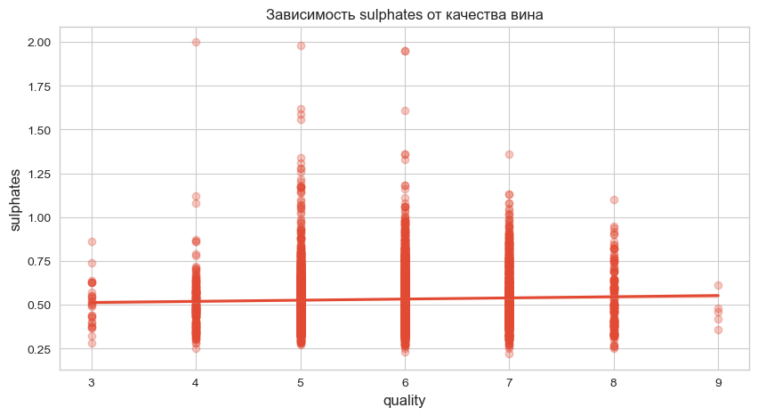

# Wine Quality Prediction: Course Project

Course project for **Algorithms and Methods** (2nd year, semester 4) at Don State Technical University (DSTU).
The goal is to predict wine quality from its physicochemical properties and to compare two model families, **Random Forest** and **Support Vector Machines**, for both classification and regression.

## Results

| Task | Random Forest | SVM |
|---|---|---|
| **Classification** into 3 quality classes (accuracy) | **84.9%** | 68.0% |
| **Regression** of the quality score (R²) | **0.525** | 0.401 |
| Regression (MSE) | **0.364** | 0.459 |

Random Forest wins on every metric, so it was chosen as the final model.



## Data

[UCI Wine Quality](https://archive.ics.uci.edu/dataset/186/wine+quality): 6,497 red and white Portuguese "Vinho Verde" wines, 11 physicochemical features (acidity, residual sugar, sulphates, alcohol, …) and an expert quality score from 0 to 10.

- Red and white wines are merged, with the wine type added as a feature.
- The quality score is grouped into **3 classes**: low (≤ 4), medium (5–6), high (≥ 7). The classes are heavily imbalanced (most wines are "medium"), so both models use `class_weight='balanced'`.
- Stratified 70 / 30 train / test split, standardised features.

## Method

1. **Exploratory analysis:** class distributions, a correlation matrix, and per-feature box plots and trends across quality classes.
2. **Random Forest** classifier and regressor with **GridSearchCV** hyperparameter tuning.
3. **SVM** classifier and regressor (SVC / SVR) with GridSearchCV.
4. **Interpretation:** impurity-based and permutation feature importance, **SHAP** values, partial-dependence-style interaction plots for pairs of features, and a visualisation of the SVM decision surface in 2D **PCA** space.

| Feature importance | SHAP summary |
|---|---|
|  |  |

**Confusion matrix (Random Forest)**



According to the Random Forest, alcohol, free sulfur dioxide and volatile acidity are the strongest predictors of quality. Most errors come from confusing the minority classes with "medium".

## Notebooks

The project was developed iteratively; each notebook extends the previous one.

| File | Content |
|---|---|
| `01_baseline_random_forest.ipynb` | First Random Forest baseline |
| `02_quality_classes.ipynb` | Grouping quality into classes, first evaluation |
| `03_model_tuning.ipynb` | Hyperparameter tuning |
| `04_feature_analysis.ipynb` | Feature analysis and visualisations |
| `05_final_random_forest_vs_svm.ipynb` | **Final version**: Random Forest vs SVM, PCA, SHAP |
| `wine_quality_analysis.py` | Script version of the analysis |
| `correlation_matrix.png`, `wine_quality_tree.dot` | Correlation matrix and an exported decision tree (Graphviz) |

## How to run

```bash
pip install numpy pandas scikit-learn matplotlib seaborn shap jupyter
jupyter notebook 05_final_random_forest_vs_svm.ipynb
```

The dataset is included (both in the root and in `wine+quality/`, matching the paths used by the notebooks).

## Tech stack

Python · scikit-learn · pandas · NumPy · SHAP · Matplotlib · seaborn

## License

Code: [MIT](LICENSE). The dataset is by P. Cortez et al., distributed by the UCI Machine Learning Repository under CC BY 4.0.
